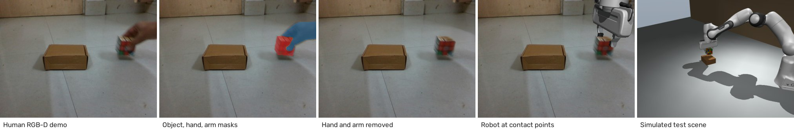

# Recast

**Object-Linked, Contact-Grounded Robot Demonstrations from Human Videos**

Recast turns third-person RGB-D recordings of a person manipulating an object into robot demonstrations, then fine-tunes [Octo](https://octo-models.github.io) on them. No robot demonstrations are needed for the target tasks. Compared with hand-only data editing, Recast adds four things:

1. **(i) Object state.** Object keypoints are tracked in 3D and expressed in the gripper frame.
2. **(ii) Interaction phases.** An HMM labels each frame as idle, approach, grasp, carry or release, and the phase sets the gripper label.
3. **(iii) Contact-based grasps.** The gripper jaws are placed at the hand–object contact points rather than at the fingertips.
4. **(iv) Object-anchored correction.** During transport, a rigid-attachment constraint corrects the end-effector pose.



## Install

```bash
uv venv -p 3.11 && source .venv/bin/activate
uv pip install -e ".[sim,dev]"                 # CPU stages, simulation, tests
./scripts/setup_gpu.sh --menagerie-only        # Franka Panda model (MuJoCo Menagerie)
```

The GPU perception stages need extra setup:

```bash
./scripts/setup_gpu.sh                         # pinned WiLoR, ProPainter, SAM 2.1 + weights
```

Then download **MANO** (licensed) from <https://mano.is.tue.mpg.de> and place it at `third_party/WiLoR/mano_data/MANO_RIGHT.pkl`.

Two stages need their own environments:
- **SAM 3 segmentation:** [`envs/sam3.txt`](envs/sam3.txt), Python 3.12.
- **Octo training:** [`envs/train.txt`](envs/train.txt), Python 3.10, JAX.

## Quick start (CPU, bundled sample)

`data/sample/cube_demo` is one recorded cube demonstration. It already contains the outputs of the GPU stages, so the rest of the pipeline runs on a laptop:

```bash
./scripts/run_sample.sh                        # keypoints -> contact -> phases -> actions -> robot render -> panels
python -m recast.sim.scripted --task cube --video outputs/cube.mp4
pytest -q
```

## Full pipeline

```bash
# 1. recording -> edited robot demonstration (GPU)
./scripts/run_pipeline.sh recording.db3 300 445 cube runs/cube_001 calib/extrinsics.json

# 2. phase model from a few labelled videos (optional; a hand-set prior is used otherwise)
python -m recast.phases fit --labels labels/cube/*.json --out models/phase_hmm_cube.json

# 3. training data (RLDS) for Octo
python -m recast.data.episodes build runs/cube_* --task cube --out datasets/recast_cube
python -m recast.data.episodes rlds datasets/recast_cube --out ~/tensorflow_datasets

# 4. fine-tune Octo-Base (training env); --variant hand_only gives the Phantom-style baseline
python -m recast.policy.finetune --data_dir ~/tensorflow_datasets --dataset recast_cube \
    --variant recast --save_dir checkpoints/recast_cube

# 5. closed-loop evaluation in MuJoCo: 25 paired placements, 60 s, Wilson intervals
python -m recast.sim.evaluate --task cube --model recast --checkpoint checkpoints/recast_cube \
    --condition in_distribution --out results/cube_recast.json
```

Every stage is also available as `recast <command>` (run `recast` to list the commands). Settings live in [`configs/`](configs): defaults, the three tasks (cube, tape, battery), the measured scene and the evaluation protocol.

## Layout

| Path | Paper | Contents |
|---|---|---|
| `recast/io` | | RealSense `.db3` export (depth aligned to colour), clip format |
| `recast/perception/segmentation.py` | (0) | text-prompted masks: SAM 3, or Grounding DINO + SAM 2 |
| `recast/perception/hands.py` | (0), eq. 1 | WiLoR MANO mesh registered to depth with ICP |
| `recast/perception/keypoints.py` | (i), eq. 2 | FPS + CoTracker keypoints, Kabsch propagation, object state |
| `recast/perception/contact.py` | (ii) | distance, contact, speed signals |
| `recast/phases.py` | (ii), eq. 3 | left-to-right HMM, Viterbi, gripper labels, phase F1 |
| `recast/actions.py` | (iii), (iv), eqs. 4–6 | contact grasp, anchoring, label consistency, action labels |
| `recast/editing` | (v) | ProPainter inpainting, depth-aware Panda compositing |
| `recast/data` | | episodes and RLDS export |
| `recast/policy` | eq. 7 | Octo point/proprio tokenizers, phase head, fine-tuning, phase gate |
| `recast/sim` | Sec. IV | MuJoCo scene and tasks, OSC, scripted demo, evaluation |
| `recast/viz` | | figure panels, showcase video |

## Status

The following have run on our recordings: perception, editing and rendering, and the scripted MuJoCo demo (Fig. 9). The bundled sample comes from that data.

The keypoint tracker, phase HMM, anchoring, Octo modules and evaluation harness are implemented and covered by the CPU test suite. This repository ships no trained checkpoints or evaluation logs.

The recordings have no camera-to-robot calibration, so the edited frames use a virtual robot base fitted to the floor (see [`data/sample/README.md`](data/sample/README.md)).

## Citation

```bibtex
@techreport{recast2026,
  title  = {Recast: Object-Linked, Contact-Grounded Robot Demonstrations from Human Videos},
  author = {Sah, Niwesh and Yadav, Rishang and Kumar, Anish and Seth, Vitthal},
  note   = {Course project, AR511/AR522},
  year   = {2026}
}
```

MIT licensed. Third-party models keep their own licenses (see [`NOTICE`](NOTICE)).
